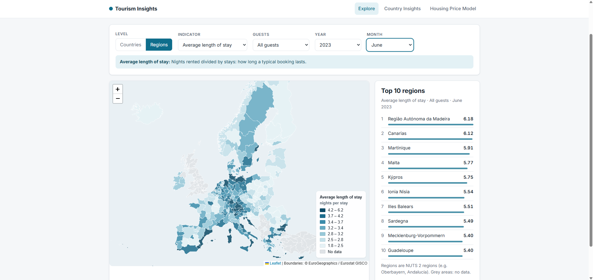
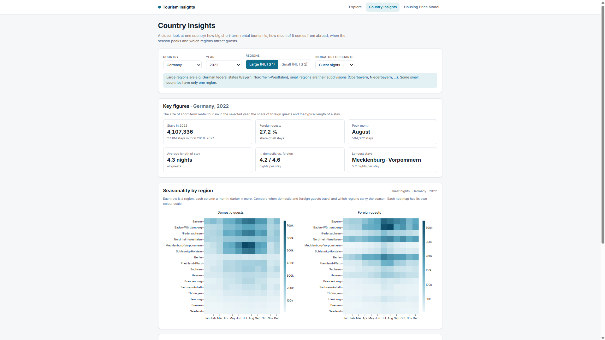
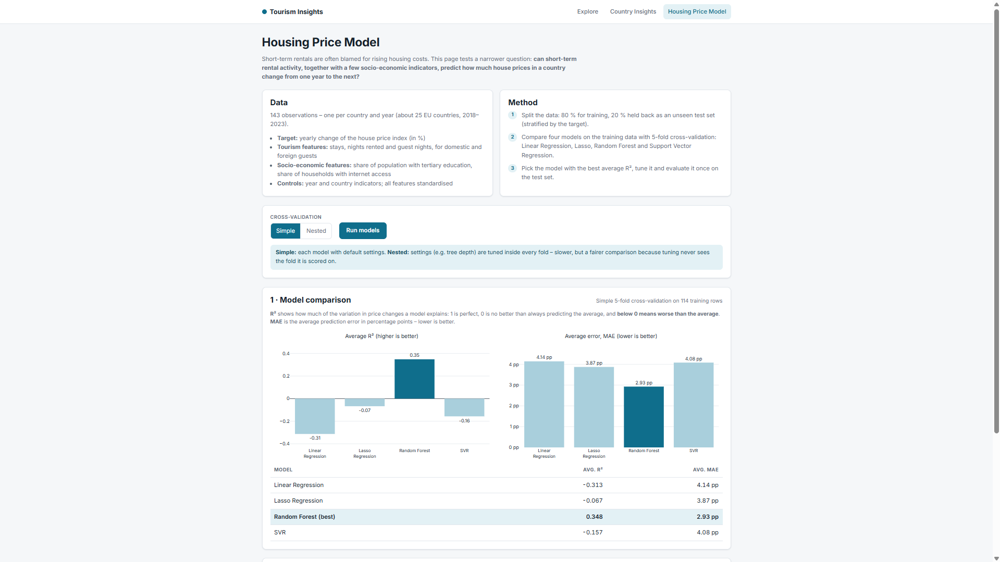

# Tourism Insights

**How do short-term rentals shape European tourism – and can they help predict housing prices?**

Tourism Insights is an interactive Flask web app built on Eurostat data about stays booked via Airbnb, Booking.com, Expedia Group and Tripadvisor in 31 European countries and their regions (2018–2024). It combines an interactive map, country-level analyses and a machine learning comparison that tries to predict yearly changes in house prices.

> University project – *Programming and Data Systems*, Lisbon School of Economics & Management (ISEG), Universidade de Lisboa. Team: Christian Wagner, Jan Hrušák, Arno Vanheule, Siyuan Yuan.

<!-- Screenshots: add images to docs/screenshots/ and uncomment



-->

## Features

| Page | What it shows |
|---|---|
| **Explore** | Choropleth map of all countries or NUTS 2 regions with a live Top 10 ranking. Choose the indicator (stays, nights rented, guest nights, average length of stay), domestic or foreign guests, year and month. |
| **Country Insights** | Key figures for one country and year (stays, share of foreign guests, peak month, average length of stay, region with the longest stays), interactive month-by-region heatmaps for domestic and foreign guests, and the monthly trend of the three largest regions – at the level of large (NUTS 1) or small (NUTS 2) regions. |
| **Housing Price Model** | Compares Linear Regression, Lasso, Random Forest and Support Vector Regression with simple or nested 5-fold cross-validation, then evaluates the best model on a held-out test set against a naive baseline. |

### What the indicators mean
Eurostat's example: a family of four staying three nights counts as **1 stay**, **3 nights rented** and **12 guest nights**. The average length of stay is nights rented divided by stays.

### Some findings
- France, Italy and Spain are consistently the largest markets; regions such as Andalucía, Adriatic Croatia and Provence-Alpes-Côte d'Azur lead among regions.
- Foreign stays dropped more sharply than domestic ones in 2020 and have grown steadily since 2021.
- In the price model, a Random Forest beats a naive guess on unseen data, while the linear models score a negative R² – the relationship between tourism indicators and house price changes is weak and non-linear.

## Tech stack
Python · Flask · pandas · NumPy · scikit-learn · Leaflet · Plotly.js · Eurostat API

## Run it locally

Requires Python 3.10 or newer.

```bash
git clone https://github.com/<your-username>/tourism-insights.git
cd tourism-insights
python -m venv .venv
# Windows: .venv\Scripts\activate    macOS/Linux: source .venv/bin/activate
pip install -r requirements.txt
python app.py        # open http://127.0.0.1:5000
```

The Eurostat data is included as a snapshot in `data/`. To download a fresh copy: `python scripts/download_data.py`.

## Project structure

```
app.py               Flask pages and JSON endpoints
data_prep.py         Loads the Eurostat data and reshapes it into one tidy table
country_insights.py  Statistics, heatmap and trend data for the Country Insights page
predictions.py       Model comparison with (nested) cross-validation and test evaluation
templates/           HTML pages (Jinja)
static/
  css/style.css      Styling
  js/                Map (Leaflet) and charts (Plotly) for each page
  geo/               Simplified country and NUTS 2 boundaries (GeoJSON)
data/
  tour_ce_omn12.csv  Eurostat snapshot
  nuts_mapping.json  NUTS code -> region name
  merged_dataX.csv / merged_dataY.csv   Prepared features and target for the models
scripts/
  download_data.py       Downloads the Eurostat dataset
  build_boundaries.py    Builds the simplified boundary files from the NUTS 2021 GeoJSON
```

## Data sources
- Eurostat, [tour_ce_omn12](https://ec.europa.eu/eurostat/databrowser/view/tour_ce_omn12/default/table) – short-stay accommodation booked via collaborative economy platforms, by month, residence of the guest and NUTS region
- Eurostat / GISCO NUTS 2021 boundaries
- Eurostat indicators on house prices, tertiary education and household internet access (model features)
